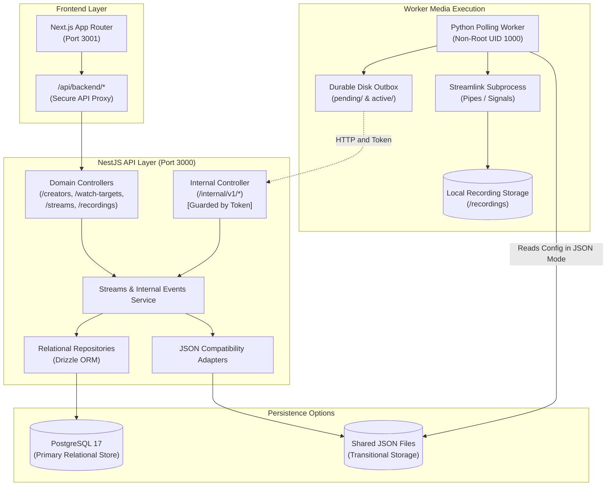

# StreamRecorder Clone

## Wave 05.5 Identity And Operational Safety / Identidade e Segurança Operacional

**English:** JSON/local remains the default: `RELATIONAL_STORAGE=false`, `PERSISTENCE_MODE=direct_json`, `IDENTITY_MODE=local`; no database or login is required and no User is created. PostgreSQL/local is explicitly opt-in with `RELATIONAL_STORAGE=true`, `DATABASE_URL`, checked-in migrations and bridge persistence; it uses one persistent bootstrap `local` User. PostgreSQL failures return 503 rather than falling back to JSON. PostgreSQL/authenticated startup is available by explicit opt-in: `IDENTITY_MODE=authenticated`, `RELATIONAL_STORAGE=true`, a valid PostgreSQL `DATABASE_URL` and non-empty exact `AUTH_TRUSTED_ORIGINS`. Startup fails closed unless PostgreSQL is reachable, Wave 05.5 ownership schema and composite constraints are installed, and an enabled password-enrolled user exists.

**Português (Brasil):** O modo JSON/local permanece o padrão: `RELATIONAL_STORAGE=false`, `PERSISTENCE_MODE=direct_json`, `IDENTITY_MODE=local`; nenhum banco ou login é exigido e nenhum Usuário é criado. O modo PostgreSQL/local é ativado explicitamente com `RELATIONAL_STORAGE=true`, `DATABASE_URL`, migrações versionadas e persistência via ponte; ele utiliza um Usuário persistente de bootstrap `local`. Falhas no PostgreSQL retornam 503 em vez de fallback para JSON. O modo PostgreSQL/autenticado é ativado explicitamente com: `IDENTITY_MODE=authenticated`, `RELATIONAL_STORAGE=true`, `DATABASE_URL` do PostgreSQL válida e `AUTH_TRUSTED_ORIGINS` exatas e não-vazias. A inicialização falha de forma estrita (fail-closed) a menos que o PostgreSQL esteja acessível, o esquema de propriedade da Wave 05.5 e restrições compostas estejam instalados e exista um usuário habilitado com senha cadastrada.

---

## Language / Idioma

- [English](#english)
- [Português (Brasil)](#português-brasil)

---

# English

## Table of Contents

- [1. Operational Checkpoint Status](#1-operational-checkpoint-status)
- [2. Overview & Core Purpose](#2-overview--core-purpose)
- [3. Features](#3-features)
- [4. Architecture & Technology Stack](#4-architecture--technology-stack)
- [5. Deployment Modes](#5-deployment-modes)
- [6. Prerequisites](#6-prerequisites)
- [7. Quickstart](#7-quickstart)
- [8. Docker Operations & Lifecycle](#8-docker-operations--lifecycle)
- [9. Environment Variables & Storage Mounts](#9-environment-variables--storage-mounts)
- [10. Database Migrations and Cutover](#10-database-migrations-and-cutover)
- [11. Account Administration CLI](#11-account-administration-cli)
- [12. Worker Lifecycle, Bridge, and Recovery](#12-worker-lifecycle-bridge-and-recovery)
- [13. Local Storage, Containment, and Retention](#13-local-storage-containment-and-retention)
- [14. Security and Privacy Boundaries](#14-security-and-privacy-boundaries)
- [15. Troubleshooting & Diagnostics](#15-troubleshooting--diagnostics)
- [16. Testing and Command Inventory](#16-testing-and-command-inventory)
- [17. Current Limitations](#17-current-limitations)
- [18. Roadmap and Milestone Status](#18-roadmap-and-milestone-status)
- [19. Runbooks, Documentation, and Evidence](#19-runbooks-documentation-and-evidence)
- [License](#license)

---

## 1. Operational Checkpoint Status

Post-Wave 05.5 operational readiness documentation; human stability testing is **not yet recorded**. No wave acceptance status is changed here. The mode contract below is the approved checkpoint target, not evidence of deployment.

## 2. Overview & Core Purpose

Local-first monitoring and private local capture for Twitch, YouTube and Kick. Cloud accounts, a VPS and external OAuth are not prerequisites. Platform/network access and permission to record remain necessary.

## 3. Features

Independent WatchTargets grouped by Creator, configurable quality/URL/folder/enabled, polling, adaptive capture, persisted Stream/Recording history, safe read-only location browsing, relational ownership and opt-in password/session authentication.

## 4. Architecture & Technology Stack

Browser → Next.js proxy → NestJS services/repositories → JSON or PostgreSQL. Independent Python Worker → Streamlink → local recordings. Relational Worker events use the internal API and durable outbox. Creator is who; WatchTarget is configuration; Stream is a broadcast; Recording is an attempt.

```text
Default Mode (Legacy JSON):
Browser -> Next.js Proxy -> NestJS API -> JSON Adapters
Python Worker -> Direct JSON Files
Streamlink Subprocess -> Local Recording Storage

Relational Bridge Mode (PostgreSQL + Bridge):
Browser -> Next.js Proxy -> NestJS API -> PostgreSQL 17 (Drizzle)
Python Worker -> Internal REST API (/internal/v1/*) -> PostgreSQL 17
Worker -> Durable Disk Outbox (pending/ & active/) -> Internal Events
Streamlink Subprocess -> Local Recording Storage
```



| Layer              | Technologies                                                                                         |
| ------------------ | ---------------------------------------------------------------------------------------------------- |
| **Frontend**       | Next.js 16 (App Router), React 19, Tailwind CSS, TypeScript 5.9                                      |
| **Backend API**    | NestJS 11, Express, Node.js >=25.9.0, TypeScript 5.7+                                                |
| **Database & ORM** | PostgreSQL 17 (`postgres:17-alpine`), Drizzle ORM 0.44+, Drizzle Kit                                 |
| **Worker & Media** | Python 3.12, Streamlink 8.6.1, FFmpeg (installed in Worker image; no separate remux command invoked) |
| **Orchestration**  | Docker & Docker Compose v2, Alpine/Debian slim base images                                           |

## 5. Deployment Modes

| Mode | Approved Compose files          | Authority / identity                      | Services                             |
| ---- | ------------------------------- | ----------------------------------------- | ------------------------------------ |
| A    | `compose.yml`                   | JSON / local                              | API, frontend, Worker; no PostgreSQL |
| B    | A + `compose.relational.yml`    | PostgreSQL / local; Worker bridge         | A + PostgreSQL 17                    |
| C    | B + `compose.authenticated.yml` | PostgreSQL / authenticated; Worker bridge | Same as B                            |

B/C require shared `INTERNAL_API_TOKEN` on API and Worker, and `POSTGRES_PASSWORD`. C additionally requires exact, non-empty browser `AUTH_TRUSTED_ORIGINS`; authentication is not implied by relational storage alone.

## 6. Prerequisites

Docker Desktop with Compose v2 and adequate disk space. Source tooling: Node >=25.9.0, pinned pnpm from `package.json`, Python 3.12 and Worker dependencies. Use isolated writable data directories for tests, never normal runtime data or retained recordings.

## 7. Quickstart

Validate the selected configuration before starting:

```powershell
docker compose -f compose.yml config --quiet
docker compose -f compose.yml up -d --build
```

For B/C include every applicable `-f` file on **each** command:

Mode B:

```powershell
docker compose -f compose.yml -f compose.relational.yml config --quiet
docker compose -f compose.yml -f compose.relational.yml up -d --build
```

Mode C:

```powershell
docker compose -f compose.yml -f compose.relational.yml -f compose.authenticated.yml config --quiet
docker compose -f compose.yml -f compose.relational.yml -f compose.authenticated.yml up -d --build
```

Provision database/schema/accounts before starting authenticated API; see sections 10–11. Use `http://127.0.0.1:3001` for the target frontend; do not mix `localhost` and `127.0.0.1` in origin/cookie tests. API status is available at `http://127.0.0.1:3000/health`.

## 8. Docker Operations & Lifecycle

Target images use `wave-05.5`. Inspect `docker compose ... ps` and bounded `logs --tail 100`; a running container is not proof of readiness. Stop with the same project/file selection. Ordinary restarts must preserve metadata, recordings and the bridge outbox. Do not use `down -v` on a retained stack.

## 9. Environment Variables & Storage Mounts

| Target setting                                           | Default / obligation                                            |
| -------------------------------------------------------- | --------------------------------------------------------------- |
| `RUNTIME_DATA_DIR`                                       | `./runtime-data`, host configuration/runtime bind mount         |
| `RECORDINGS_DIR`                                         | `./recordings`, host media bind mount; API read-only            |
| `API_HOST_PORT` / `FRONTEND_HOST_PORT` / `POSTGRES_PORT` | 3000 / 3001 / 5432, loopback bindings                           |
| `RELATIONAL_STORAGE` / `IDENTITY_MODE`                   | A: false/local; B: true/local; C: true/authenticated            |
| `PERSISTENCE_MODE`                                       | A: direct_json; B/C: bridge                                     |
| `OUTBOX_DIR`                                             | B/C: `/outbox`, persistent named volume `worker-outbox`         |
| `POSTGRES_PASSWORD` / `INTERNAL_API_TOKEN`               | Required B/C, private configuration; no real values in docs/Git |
| `AUTH_TRUSTED_ORIGINS`                                   | Required C; exact browser origin including scheme and port      |

Container paths are Linux paths even on Windows. API `RECORDINGS_ROOT` and Worker `OUTPUT_DIR` refer to `/recordings`; `CONFIG_DIR` refers to `/data`. Never publish expanded Compose configuration containing secrets.

## 10. Database Migrations and Cutover

Startup does not apply migrations or import JSON. In a built production API image use `node dist/database/migrate.js`; the approved wrapper is `db:migrate:prod`. Source checkout command: `pnpm --dir api db:migrate`. Migration execution was verified against an isolated disposable PostgreSQL 17 container. For existing JSON follow the quiesced dry-run → backup → import → verify → cutover-check procedure in [database runbook](api/README.database.md). Retain backups; never switch back to stale JSON after relational writes.

## 11. Account Administration CLI

Verified syntax: `create <username> [--email <email>]`, `set-password <username>`, `disable <username>`, `enable <username>`, `list`. Source: `pnpm --dir api users <command>`. Production: `node dist/auth/users-cli.js <command>`; wrapper `users:prod`. Passwords use a no-echo prompt or controlled stdin, never argv. Non-interactive automated user creation via stdin was verified in an isolated production container without password exposure in logs or arguments; interactive no-echo TTY verification remains reserved for manual testing. Use one-off API containers when authenticated startup is blocked; `exec` requires a running container. C startup requires reachable migrated PostgreSQL, ownership constraints and an enabled password-enrolled user.

## 12. Worker Lifecycle, Bridge, and Recovery

Disabled targets launch no new work; active captures and pending terminal persistence continue independently. Probe ERROR is not OFFLINE. Quality fallback does not alter preference. B/C retain pending/active outbox records across recreation; restore connectivity and observe acknowledgment before declaring recovery. Do not manually delete or edit outbox entries.

## 13. Local Storage, Containment, and Retention

Retained local output is user data, not a cloud staging buffer. `recording_subdir` is relative to the configured root; traversal and unsafe links are rejected. Browsing is metadata-only, not playback/download. Keep history when a file is missing. Back up database, runtime configuration, outbox and media consistently after quiescing the Worker.

## 14. Security and Privacy Boundaries

A/B are trusted-local modes, not secured hosting. C uses host-only HttpOnly sessions and backend ownership checks; the internal token authenticates the Worker, not people. Keep ports loopback, secrets out of logs and recordings private. Account provisioning is CLI-only. Users must comply with copyright and platform rules.

## 15. Troubleshooting & Diagnostics

For startup failure check selected files, required variables, database/schema/account prerequisites and exact trusted origin. For 401/403 distinguish session, ownership, origin and internal-token failures. For stale recording state inspect Worker diagnostics and pending outbox; there is no heartbeat. For missing files check mounts/permissions/root before changing metadata. Never repair failure by deleting retained state.

## 16. Testing and Command Inventory

Approved root interface: `test` runs API/frontend/Worker only; aliases `test:api`, `test:frontend`, `test:worker`, `typecheck`, `build`, `test:db`, `test:rehearsal`, `compose:config`, `compose:config:relational`, `compose:config:authenticated`. These commands are available from the repository root. Existing `test:smoke`, `test:smoke:json`, `test:smoke:bridge`, `lint` and `format:check` remain available. Source checks include `pnpm --dir api test --runInBand`, `pnpm --dir frontend test`, and Worker unittest discovery. Database/rehearsal/smoke checks are separate isolated operations, not implied by unit-test success.

## 17. Current Limitations

Success uses `finished`; zero exit plus nonempty output does not prove playable MP4. FFmpeg is installed but no separate finalization command is invoked. Legacy links may be unknown. No queue jobs, Worker heartbeat, SSE, cloud export or desktop packaging. Faster dashboard polling does not accelerate capture detection.

## 18. Roadmap and Milestone Status

See [PROJECT-STATUS.md](PROJECT-STATUS.md). This checkpoint improves operational guidance after Wave 05.5; it does not implement future queue, storage-management, realtime, desktop or cloud milestones.

## 19. Runbooks, Documentation, and Evidence

- [Human Docker stability matrix and safe cleanup](docs/DOCKER-STABILITY-TESTING.md)
- [Database authority, migration and recovery](api/README.database.md)
- [API Documentation](api/README.md)
- [Frontend Documentation](frontend/README.md)
- [Worker Documentation](worker/README.md)
- [Repository Linting and Formatting Guide](README-LINTING.md)

Record actual commands, timestamps, isolated project/data paths and observed results. Blank human-test cells are unexecuted, not PASS. Component guides retain detailed English/Portuguese reference material.

## License

This project is licensed under the terms described in [LICENSE](LICENSE).

---

# Português (Brasil)

## Índice de Conteúdo

- [1. Status do Checkpoint Operacional](#1-status-do-checkpoint-operacional)
- [2. Visão Geral e Propósito Central](#2-visão-geral-e-propósito-central)
- [3. Funcionalidades](#3-funcionalidades)
- [4. Arquitetura e Stack Tecnológica](#4-arquitetura-e-stack-tecnológica)
- [5. Modos de Implantação](#5-modos-de-implantação)
- [6. Pré-requisitos](#6-pré-requisitos)
- [7. Início Rápido](#7-início-rápido)
- [8. Operações e Ciclo de Vida do Docker](#8-operações-e-ciclo-de-vida-do-docker)
- [9. Variáveis de Ambiente e Volumes](#9-variáveis-de-ambiente-e-volumes)
- [10. Migrações de Banco de Dados e Corte de Autoridade](#10-migrações-de-banco-de-dados-e-corte-de-autoridade)
- [11. CLI de Administração de Contas](#11-cli-de-administração-de-contas)
- [12. Ciclo de Vida do Worker, Ponte e Recuperação](#12-ciclo-de-vida-do-worker-ponte-e-recuperação)
- [13. Armazenamento Local, Contenção e Retenção](#13-armazenamento-local-contenção-e-retenção)
- [14. Fronteiras de Segurança e Privacidade](#14-fronteiras-de-segurança-e-privacidade)
- [15. Solução de Problemas e Diagnósticos](#15-solução-de-problemas-e-diagnósticos)
- [16. Testes e Inventário de Comandos](#16-testes-e-inventário-de-comandos)
- [17. Limitações Atuais](#17-limitações-atuais)
- [18. Roadmap e Status dos Marcos](#18-roadmap-e-status-dos-marcos)
- [19. Guias Operacionais, Documentação e Evidências](#19-guias-operacionais-documentação-e-evidências)
- [Licença](#licença)

---

## 1. Status do Checkpoint Operacional

Documentação de prontidão operacional pós-Wave 05.5; os testes de estabilidade humana **ainda não foram registrados**. Nenhum status de aceitação de onda foi alterado aqui. O contrato de modos abaixo é a meta aprovada do checkpoint, não evidência de implantação final.

## 2. Visão Geral e Propósito Central

Monitoramento local-first e captura local privada para Twitch, YouTube e Kick. Contas em nuvem, servidores VPS e autenticação OAuth externa não são pré-requisitos. O acesso à rede/plataforma e as devidas permissões para gravação continuam necessários.

## 3. Funcionalidades

Alvos de monitoramento (`WatchTarget`) independentes agrupados por Criador (`Creator`), qualidade/URL/pasta/habilitação configuráveis, sondagem contínua, captura adaptativa, histórico persistido de transmissões (`Stream`) e gravações (`Recording`), navegação segura somente-leitura pelo sistema de arquivos, propriedade relacional de recursos e autenticação opcional por senha/sessão.

## 4. Arquitetura e Stack Tecnológica

Navegador → Proxy Next.js → Serviços/Repositórios NestJS → JSON ou PostgreSQL. Worker Python independente → Streamlink → gravações locais. No modo relacional, eventos do Worker utilizam a API interna e outbox durável em disco. `Creator` representa quem; `WatchTarget` representa a configuração; `Stream` representa uma transmissão ao vivo real; `Recording` representa uma tentativa física de captura.

```text
Modo Padrão (JSON Legado):
Navegador -> Proxy Next.js -> API NestJS -> Adaptadores JSON
Worker Python -> Arquivos JSON Diretos
Subprocesso Streamlink -> Armazenamento Local de Gravações

Modo Ponte Relacional (PostgreSQL + Ponte):
Navegador -> Proxy Next.js -> API NestJS -> PostgreSQL 17 (Drizzle)
Worker Python -> API REST Interna (/internal/v1/*) -> PostgreSQL 17
Worker -> Outbox Durável em Disco (pending/ e active/) -> Eventos Internos
Subprocesso Streamlink -> Armazenamento Local de Gravações
```

| Camada                   | Tecnologias                                                                                           |
| ------------------------ | ----------------------------------------------------------------------------------------------------- |
| **Frontend**             | Next.js 16 (App Router), React 19, Tailwind CSS, TypeScript 5.9                                       |
| **API Backend**          | NestJS 11, Express, Node.js >=25.9.0, TypeScript 5.7+                                                 |
| **Banco de Dados & ORM** | PostgreSQL 17 (`postgres:17-alpine`), Drizzle ORM 0.44+, Drizzle Kit                                  |
| **Worker & Mídia**       | Python 3.12, Streamlink 8.6.1, FFmpeg (instalado na imagem do Worker; sem comando de remux explícito) |
| **Orquestração**         | Docker & Docker Compose v2, imagens base Alpine/Debian slim                                           |

## 5. Modos de Implantação

| Modo | Arquivos Compose Aprovados      | Autoridade / Identidade                   | Serviços                              |
| ---- | ------------------------------- | ----------------------------------------- | ------------------------------------- |
| A    | `compose.yml`                   | JSON / local                              | API, frontend, Worker; sem PostgreSQL |
| B    | A + `compose.relational.yml`    | PostgreSQL / local; ponte do Worker       | A + PostgreSQL 17                     |
| C    | B + `compose.authenticated.yml` | PostgreSQL / autenticado; ponte do Worker | Idêntico ao B                         |

Os Modos B e C exigem `INTERNAL_API_TOKEN` compartilhado entre API e Worker, e `POSTGRES_PASSWORD`. O Modo C exige adicionalmente `AUTH_TRUSTED_ORIGINS` exata e não-vazia para o navegador; a autenticação não é ativada apenas pela presença do banco relacional.

## 6. Pré-requisitos

Docker Desktop com Compose v2 e espaço em disco suficiente. Ferramentas para execução via código-fonte: Node >=25.9.0, pnpm fixado no `package.json`, Python 3.12 e dependências do Worker. Utilize diretórios de dados descartáveis e isolados para testes, nunca dados reais de produção ou gravações retidas.

## 7. Início Rápido

Valide a configuração selecionada antes de inicializar:

```powershell
docker compose -f compose.yml config --quiet
docker compose -f compose.yml up -d --build
```

Para os Modos B e C, inclua todos os arquivos `-f` correspondentes em **cada** comando:

Modo B:

```powershell
docker compose -f compose.yml -f compose.relational.yml config --quiet
docker compose -f compose.yml -f compose.relational.yml up -d --build
```

Modo C:

```powershell
docker compose -f compose.yml -f compose.relational.yml -f compose.authenticated.yml config --quiet
docker compose -f compose.yml -f compose.relational.yml -f compose.authenticated.yml up -d --build
```

Provisione o banco, esquema e contas de usuário antes de inicializar a API autenticada (consulte as seções 10 e 11). Acesse o painel pelo endereço `http://127.0.0.1:3001`; não misture `localhost` e `127.0.0.1` em testes de origem/cookies. O status da API pode ser verificado em `http://127.0.0.1:3000/health`.

## 8. Operações e Ciclo de Vida do Docker

As imagens-alvo utilizam a tag `wave-05.5`. Inspecione `docker compose ... ps` e logs limitados `logs --tail 100`; um container em execução não comprova prontidão operacional. Interrompa a stack com a mesma seleção de arquivos e projeto. Reinicializações normais devem preservar metadados, gravações e a outbox da ponte. Nunca execute `down -v` em uma stack de dados retidos.

## 9. Variáveis de Ambiente e Volumes

| Configuração Alvo                                        | Padrão / Obrigação                                                       |
| -------------------------------------------------------- | ------------------------------------------------------------------------ |
| `RUNTIME_DATA_DIR`                                       | `./runtime-data`, montagem bind de configuração/runtime no host          |
| `RECORDINGS_DIR`                                         | `./recordings`, montagem bind de mídia no host; API somente leitura      |
| `API_HOST_PORT` / `FRONTEND_HOST_PORT` / `POSTGRES_PORT` | 3000 / 3001 / 5432, vinculados a loopback                                |
| `RELATIONAL_STORAGE` / `IDENTITY_MODE`                   | A: false/local; B: true/local; C: true/authenticated                     |
| `PERSISTENCE_MODE`                                       | A: direct_json; B/C: bridge                                              |
| `OUTBOX_DIR`                                             | B/C: `/outbox`, volume nomeado persistente `worker-outbox`               |
| `POSTGRES_PASSWORD` / `INTERNAL_API_TOKEN`               | Obrigatórios em B/C, configuração privada; sem valores reais em docs/Git |
| `AUTH_TRUSTED_ORIGINS`                                   | Obrigatório em C; origem exata do navegador incluindo protocolo e porta  |

Caminhos em containers são caminhos Linux, mesmo no Windows. Na API, `RECORDINGS_ROOT` e no Worker `OUTPUT_DIR` apontam para `/recordings`; `CONFIG_DIR` aponta para `/data`. Nunca exponha arquivos Compose expandidos contendo senhas ou tokens reais.

## 10. Migrações de Banco de Dados e Corte de Autoridade

A inicialização não executa migrações automáticas nem importa dados JSON. Na imagem de produção da API, execute `node dist/database/migrate.js` (atalho aprovado: `db:migrate:prod`). Em ambiente de desenvolvimento: `pnpm --dir api db:migrate`. A execução de migrações foi verificada em um container isolado descartável com PostgreSQL 17. Para migrar dados legados de JSON, siga o procedimento quiescido: dry-run → backup → import → verify → cutover-check detalhado no [runbook de banco de dados](api/README.database.md). Mantenha backups verificados; nunca reverta para arquivos JSON obsoletos após escritas relacionais.

## 11. CLI de Administração de Contas

Sintaxe verificada: `create <username> [--email <email>]`, `set-password <username>`, `disable <username>`, `enable <username>`, `list`. Código-fonte: `pnpm --dir api users <comando>`. Produção: `node dist/auth/users-cli.js <comando>`; wrapper `users:prod`. Senhas utilizam prompt sem eco ou entrada controlada via stdin, nunca argumentos de linha de comando. A criação automatizada não-interativa via stdin foi verificada em container de produção isolado sem exposição de senhas em logs ou argumentos; a verificação interativa em TTY sem eco permanece reservada para avaliação manual. Utilize containers API descartáveis avulsos quando a inicialização autenticada estiver bloqueada; o comando `exec` requer containers ativos. A inicialização no Modo C exige PostgreSQL acessível e migrado, restrições de propriedade aplicadas e um usuário habilitado com senha cadastrada.

## 12. Ciclo de Vida do Worker, Ponte e Recuperação

Alvos desabilitados não iniciam novas sondagens ou gravações; capturas ativas e persistências terminais pendentes continuam de forma independente. Erro de sondagem (`ERROR`) não significa que o canal está `OFFLINE`. Fallback de qualidade adaptativa não altera a preferência gravada. Os Modos B e C preservam eventos pendentes e ativos na outbox entre recriações de containers; restabeleça a conexão e observe a confirmação durável antes de declarar a recuperação concluída. Nunca apague arquivos da outbox manualmente.

## 13. Armazenamento Local, Contenção e Retenção

Arquivos locais concluídos são dados do usuário, não um buffer transitório de nuvem. O diretório `recording_subdir` é relativo à raiz configurada; caracteres de travessia de diretório e links inseguros são rejeitados. A navegação na API é restrita a metadados, sem reprodução ou download de mídia. O histórico é preservado mesmo se o arquivo físico estiver ausente. Faça backup coordenado do banco de dados, arquivos de configuração, outbox e mídia com o Worker quiescido.

## 14. Fronteiras de Segurança e Privacidade

Os Modos A e B destinam-se a ambientes locais confiáveis, não a hospedagem multiusuário exposta. O Modo C utiliza cookies de sessão HttpOnly com flag SameSite e validação de propriedade no backend; o token interno autentica exclusivamente o Worker, não pessoas. Portas permanecem restritas a loopback `127.0.0.1`, sem segredos em logs e com gravações privadas. O provisionamento de usuários ocorre exclusivamente via CLI. Os usuários permanecem responsáveis pelo cumprimento das regras de direitos autorais e dos termos das plataformas.

## 15. Solução de Problemas e Diagnósticos

Para falhas de inicialização, verifique os arquivos Compose selecionados, variáveis obrigatórias, migrações aplicadas e origens confiáveis exatas. Em erros 401/403, diferencie problemas de sessão, propriedade de recursos, origem ou token interno. Em casos de status estagnado, verifique os diagnósticos do Worker e eventos pendentes na outbox; não há heartbeat ativo. Se arquivos não forem encontrados, valide montagens e permissões antes de alterar metadados. Nunca tente reparar falhas excluindo dados retidos.

## 16. Testes e Inventário de Comandos

Interface aprovada na raiz: `test` executa apenas API, frontend e testes unitários do Worker; atalhos: `test:api`, `test:frontend`, `test:worker`, `typecheck`, `build`, `test:db`, `test:rehearsal`, `compose:config`, `compose:config:relational`, `compose:config:authenticated`. Estes comandos estão disponíveis na raiz do repositório. Os comandos existentes `test:smoke`, `test:smoke:json`, `test:smoke:bridge`, `lint` e `format:check` permanecem disponíveis. Verificações nos pacotes incluem `pnpm --dir api test --runInBand`, `pnpm --dir frontend test` e descoberta de unittests no Worker. Verificações de banco, rehearsal e fumaça Docker são operações isoladas, não implícitas pelo sucesso dos testes unitários.

## 17. Limitações Atuais

Capturas bem-sucedidas utilizam o status `finished`; código de saída zero e arquivo não-vazio não comprovam integridade de reprodução de MP4. O FFmpeg está instalado, mas nenhum comando de finalização explícito é disparado separadamente. Links em históricos legados podem constar como desconhecidos. Não há filas com Redis/BullMQ, heartbeat do Worker, SSE, exportação para nuvem ou empacotamento desktop. Acelerar o polling do painel não antecipa a detecção pelo Worker.

## 18. Roadmap e Status dos Marcos

Consulte [PROJECT-STATUS.md](PROJECT-STATUS.md). Este checkpoint consolida instruções operacionais após a Wave 05.5; ele não antecipa filas, gestão avançada de armazenamento, mensageria em tempo real, aplicativo desktop ou integração com provedores em nuvem.

## 19. Guias Operacionais, Documentação e Evidências

- [Matriz de estabilidade humana no Docker e limpeza segura](docs/DOCKER-STABILITY-TESTING.md)
- [Autoridade de banco de dados, migração e recuperação](api/README.database.md)
- [Documentação da API](api/README.md)
- [Documentação do Frontend](frontend/README.md)
- [Documentação do Worker](worker/README.md)
- [Guia de Formatação e Linting do Repositório](README-LINTING.md)

Registre comandos reais, horários, caminhos de projetos e dados isolados e resultados observados. Células de testes manuais em branco significam testes não executados, não aprovação. Guias específicos dos componentes mantêm documentação técnica bilíngue detalhada.

## Licença

Este projeto é distribuído sob os termos descritos no arquivo [LICENSE](LICENSE).
