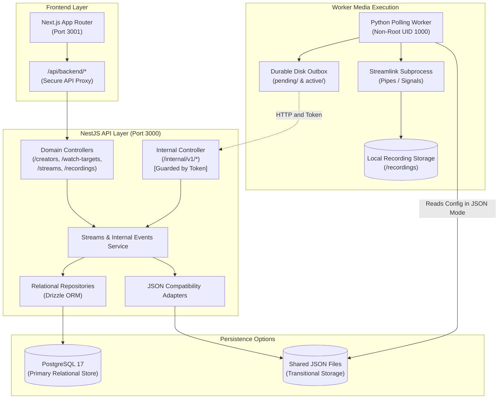

# StreamRecorder Clone

## Wave 05.5 Identity And Operational Safety

JSON/local remains the default: `RELATIONAL_STORAGE=false`,
`PERSISTENCE_MODE=direct_json`, `IDENTITY_MODE=local`; no database or login is
required and no User is created. PostgreSQL/local is explicitly opt-in with
`RELATIONAL_STORAGE=true`, `DATABASE_URL`, checked-in migrations and bridge
persistence; it uses one persistent bootstrap `local` User. PostgreSQL failures
return 503 rather than falling back to JSON.

JSON/authenticated is unsupported. PostgreSQL/authenticated startup is available
by explicit opt-in: `IDENTITY_MODE=authenticated`, `RELATIONAL_STORAGE=true`,
a valid PostgreSQL `DATABASE_URL` and non-empty exact `AUTH_TRUSTED_ORIGINS`.
Startup fails closed unless PostgreSQL is reachable, Wave 05.5 ownership schema
and composite constraints are installed, and an enabled password-enrolled user exists. Do not expose this local-first
application as a hosted multi-user service.

Accounts are CLI-only, without public registration or default credentials.
Use `pnpm --dir api users create <username>` and its no-echo password prompt
(or private stdin), never a password argument. Enable/disable and password
administration, trusted origins, session cookies, backup/import/cutover and
safe relational/local rollback are documented in
[API database operations](api/README.database.md#wave-055-operations-supported-modes-and-activation-gate).
Keep internal tokens and database credentials server-side and recordings private.
Quiesce writers, drain the Worker outbox and retain verified backups before
migration; never auto-reassign ownership or switch back to JSON after relational
writes. Local shared-root browsing is a trusted single-operator privacy limitation.

The scope remains local-first: no public media, per-user physical folders,
public signup, hosted deployment, Redis, Tags, SSE or cloud export. Fake capture
fixtures do not prove playable MP4. Integration QA and documentation do not
constitute final Coordinator validation, independent review or human acceptance.

Automated live stream monitoring and local recording capture for Twitch, YouTube, and Kick. Built as a local-first application with a modular NestJS API, Python Worker, Next.js dashboard, and dual persistence options (transitional shared JSON and robust PostgreSQL with Drizzle ORM).

---

## Language / Idioma

- [English](#english)
- [Português (Brasil)](#português-brasil)

---

# English

## Table of Contents

- [Overview](#overview)
- [What StreamRecorder Clone Does](#what-streamrecorder-clone-does)
- [Current Implemented Features](#current-implemented-features)
- [Architecture Overview](#architecture-overview)
- [Technology Stack](#technology-stack)
- [Local Quick Start with Docker Compose](#local-quick-start-with-docker-compose)
- [JSON vs PostgreSQL Persistence Modes](#json-vs-postgresql-persistence-modes)
- [Worker Persistence Bridge and Durable Outbox](#worker-persistence-bridge-and-durable-outbox)
- [Legacy JSON Migration and Authority Cutover](#legacy-json-migration-and-authority-cutover)
- [Testing and Docker Integration QA](#testing-and-docker-integration-qa)
- [Configuration and Environment Variables](#configuration-and-environment-variables)
- [Recording Storage, Security, and Privacy](#recording-storage-security-and-privacy)
- [Current Limitations](#current-limitations)
- [Roadmap and Project Status](#roadmap-and-project-status)
- [Component Documentation Links](#component-documentation-links)
- [License](#license)

---

## Overview

StreamRecorder Clone is an open-source, local-first streaming tool inspired by StreamRecorder. It is engineered to monitor content creators across live-streaming platforms and automatically capture their broadcasts into private, local video files.

The product prioritizes:
- **Local-first execution**: Complete core functionality runs on the user's computer without requiring cloud services, external OAuth, or hosted infrastructure.
- **Architectural separation**: Clear boundaries between Creator identity, WatchTarget monitoring configurations, actual broadcast Streams, and physical Recording capture attempts.
- **Reliable operation**: Cooperative subprocess control, adaptive quality fallback, durable outbox event recovery, and transactional database integrity.

---

## What StreamRecorder Clone Does

1. **Monitors Creators**: Periodically checks live status on Twitch, YouTube, and Kick based on configured WatchTargets.
2. **Classifies Live Status**: Distinguishes confirmed `LIVE`, confirmed `OFFLINE`, and platform/network `ERROR` states to prevent premature stream closure or false capture attempts.
3. **Selects Quality Adaptively**: Attempts to record at the user's preferred quality (e.g. `1080p60`, `best`, `720p`), with graceful runtime fallback to the next best available variant without rewriting the saved configuration.
4. **Captures Streams**: Launches and supervises Streamlink processes with clean termination and signal propagation (SIGTERM).
5. **Persists History**: Records broadcast intervals, capture metadata, and local output file locations into durable storage.
6. **Provides Local Management**: Exposes an operational Next.js web dashboard with real-time polling, safe folder browsing, and configuration CRUD.

---

## Current Implemented Features

- **Domain Model Separation**:
  - `Creator`: Stable identity of the content creator.
  - `WatchTarget`: Independent monitoring configuration (platform, channel, quality, authoritative URL, relative recording subdirectory, enabled state). A single Creator can hold multiple independent WatchTargets.
  - `Stream`: A specific detected broadcast occurrence.
  - `Recording`: A concrete capture attempt linked to a known Stream.
- **Platform Support**: Twitch, YouTube, and Kick live-stream probing and capturing.
- **Subprocess & Signal Lifecycle**: Non-root containerized Python Worker with cooperative subprocess shutdown, graceful SIGTERM handling, and orphan process reaping.
- **PostgreSQL 17 & Drizzle ORM**: Complete relational schema with declarative composite foreign keys `(stream_id, watch_target_id)` enforcing target consistency, immutable configuration snapshots (`channel_name`, `platform`, `quality`), and typed `timestamptz` instants.
- **Dual Persistence Modes**:
  - *Default Mode*: Shared JSON files (`watchlist.json`, `channels_status.json`, `streams.json`, `sessions.json`).
  - *Relational Bridge Mode*: PostgreSQL domain authority via an internal REST bridge with durable outbox.
- **Worker Persistence Bridge**: Option A architecture where the Worker communicates with the NestJS API via HTTP (`/internal/v1/*`) protected by an internal token. The Worker never opens a direct database connection.
- **Durable Disk Outbox**: FIFO-ordered local outbox (`outbox/pending/` and `outbox/active/`) with fail-closed startup recovery, active session checkpoints, and exponential retry backoff with jitter.
- **Legacy Migration CLI**: Comprehensive opt-in migration tool with non-destructive `dry-run`, `backup` with SHA-256 manifests, transactional `import`, post-import `verify`, and `cutover-check`.
- **Private Filesystem Browser**: Read-only in-app folder picker and path validator enforcing root containment and symlink traversal restrictions.
- **Hardened Local Networking**: Host ports published to loopback `127.0.0.1` by default to safeguard unauthenticated local development.

---

## Architecture Overview

```text
Default Mode (Legacy JSON):
Browser -> Next.js Proxy -> NestJS API -> JSON Adapters
Python Worker -> Direct JSON Files
Streamlink Subprocess -> Local Recording Storage

Relational Opt-in Mode (PostgreSQL + Bridge):
Browser -> Next.js Proxy -> NestJS API -> PostgreSQL (Drizzle)
Python Worker -> Internal REST API (/internal/v1/*) -> PostgreSQL
Worker -> Durable Disk Outbox (pending/ & active/) -> Internal Events
Streamlink Subprocess -> Local Recording Storage
```



---

## Technology Stack

| Layer | Technologies |
|---|---|
| **Frontend** | Next.js 16 (App Router), React 19, Tailwind CSS, TypeScript 5.9 |
| **Backend API** | NestJS 11, Express, Node.js 24/25, TypeScript 5.7+ |
| **Database & ORM** | PostgreSQL 17 (`postgres:17-alpine`), Drizzle ORM 0.44+, Drizzle Kit |
| **Worker & Media** | Python 3.12, Streamlink 8.6.1, FFmpeg (stream remuxing) |
| **Orchestration** | Docker & Docker Compose v2, Alpine/Debian slim base images |

---

## Local Quick Start with Docker Compose

### Prerequisites

- Docker Desktop with Docker Compose v2.
- Git.
- For local (non-Docker) development: Node.js `>=25.9.0`, pnpm, Python 3.10+, Streamlink 8.6.1, and FFmpeg.

### 1. Start the Stack (Default JSON Mode)

From the repository root, start all containers:

```sh
docker compose up -d --build
```

Access the application:
- **Dashboard UI**: [http://localhost:3001](http://localhost:3001)
- **API Health**: [http://localhost:3000/health](http://localhost:3000/health)
- **Frontend Health**: [http://localhost:3001/health](http://localhost:3001/health)

Host ports are bound to loopback `127.0.0.1` by default to safeguard unauthenticated local development.

*Note on PostgreSQL service:* The `postgres` container starts with `docker compose up`, but in default JSON mode it is kept in standby and is not a functional dependency for the API (startup is decoupled).

### 2. Service Management and Logs

Check container states:

```sh
docker compose ps
```

`api` and `frontend` report `healthy` after their HTTP healthchecks pass. HTTP `healthy` indicates the service accepts requests; it does not prove active stream detection. `worker` runs as a continuous non-root background process.

Follow logs for debugging:

```sh
docker compose logs -f api
docker compose logs -f worker
docker compose logs -f frontend
```

To stop containers while preserving data volumes:

```sh
docker compose stop
```

To take down containers and the internal network:

```sh
docker compose down
```

---

## JSON vs PostgreSQL Persistence Modes

| Mode | API Authority | Worker Persistence | Default `compose.yml` Configuration |
|---|---|---|---|
| **JSON (Default)** | Shared JSON adapters | Direct JSON files | API: `RELATIONAL_STORAGE: "false"`, Worker: `PERSISTENCE_MODE: direct_json` |
| **Relational Bridge (Opt-in)** | PostgreSQL 17 (Drizzle ORM) | Internal API (`/internal/v1/*`) + Durable Outbox | API: `RELATIONAL_STORAGE: "true"`, `PERSISTENCE_MODE: bridge`; Worker: `PERSISTENCE_MODE: bridge` |

> **Critical Operational Guardrails**:
> 1. **PostgreSQL container presence vs domain authority**: The `postgres` container starts automatically with `docker compose up` to ensure persistent storage readiness. However, in default JSON mode, **PostgreSQL is not the domain authority** and is not an operational requirement for the API (startup is decoupled). Shared JSON files remain the primary authority.
> 2. **Explicit service configuration in `compose.yml`**: In `compose.yml`, `RELATIONAL_STORAGE: "false"` and `PERSISTENCE_MODE: direct_json` are explicitly set on the service definitions. Therefore, **adding `RELATIONAL_STORAGE=true` to an ambient `.env` file does NOT activate relational mode in Docker Compose**.
> 3. **No implicit override**: Never name relational configuration `compose.override.yml`, because Docker Compose automatically loads that filename on plain `docker compose up`, which would trigger an uncoordinated, unauthorized cutover.
> 4. **Overrides do not replace migration**: An override file only configures container environment and volume bindings; it does **not** execute schema migrations, data import, or outbox quiescence. Activating relational writers against an unmigrated database risks data loss or split-brain state.

To run in **Relational Bridge Mode** safely after completing all migration prerequisites, use an explicitly named private override file (e.g. `compose.relational.local.yml`, which is git-ignored):

```yaml
# compose.relational.local.yml (MUST be invoked explicitly, never implicitly)
services:
  api:
    environment:
      RELATIONAL_STORAGE: "true"
      PERSISTENCE_MODE: bridge
      INTERNAL_API_TOKEN: "${INTERNAL_API_TOKEN:?A private secret token is required}"
      DATABASE_URL: "postgresql://${POSTGRES_USER:-streamrecorder}:${POSTGRES_PASSWORD:-streamrecorder_dev_local}@postgres:5432/${POSTGRES_DB:-streamrecorder}"

  worker:
    environment:
      PERSISTENCE_MODE: bridge
      PERSISTENCE_BRIDGE_URL: "http://api:3000"
      INTERNAL_API_TOKEN: "${INTERNAL_API_TOKEN:?A private secret token is required}"
      OUTBOX_DIR: /outbox
    volumes:
      - worker_outbox:/outbox

volumes:
  worker_outbox:
```

### Pre-requisites Before Starting in Relational Mode

Do **not** launch the relational stack on an unmigrated database or existing installation without following the strict migration sequence:

1. **Validate Configuration**:
   ```sh
   docker compose -f compose.yml -f compose.relational.local.yml config --quiet
   ```
2. **Apply Database Migrations**:
   ```sh
   # On clean or upgraded database
   docker compose exec api node dist/database/migrate.js
   ```
3. **Execute Historical Data Migration (for existing installations)**:
   Never launch relational writers against historical JSON data without executing the explicit, quiesced CLI migration runbook (`dry-run`, `backup`, `import`, `verify`, and `cutover-check` with drained outbox) documented in the [Database Runbook](api/README.database.md).
4. **Launch Coordinated Relational Services**:
   Only after migrations and cutover checks succeed, start the stack with both files specified explicitly:
   ```sh
   docker compose -f compose.yml -f compose.relational.local.yml up -d
   ```

---

## Worker Persistence Bridge and Durable Outbox

The Python Worker uses the **Option A persistence bridge**:
- **Zero Direct Database Coupling**: The Worker never connects directly to PostgreSQL. It communicates strictly via HTTP with the NestJS API.
- **Fail-Closed Security**: Both API and Worker require matching `INTERNAL_API_TOKEN`. Missing or blank tokens fail closed.
- **Outbox Architecture**:
  - `outbox/pending/`: Stores unacknowledged events in `{timestamp_ms}_{sequence}_{event_id}.json` format.
  - `outbox/active/`: Holds ongoing session checkpoints with PID tracking.
- **Restart Recovery**: On startup, `recover()` scans checkpoints. Interrupted captures with dead PIDs are marked as `error` (reason: `worker_restart_interruption`), while pending events are replayed with exponential backoff and jitter.

---

## Legacy JSON Migration and Authority Cutover

Existing installations with data in `watchlist.json`, `streams.json`, and `sessions.json` migrate using the built-in CLI:

```sh
# 1. Non-destructive validation
pnpm --dir api migrate:legacy dry-run --source /path/to/runtime-data

# 2. Quiesced backup with SHA-256 manifest
pnpm --dir api migrate:legacy backup --source /path/to/runtime-data --destination /path/to/backup --quiesced

# 3. Transactional import into PostgreSQL
pnpm --dir api migrate:legacy import --snapshot /path/to/backup --manifest /path/to/backup/manifest.json --quiesced

# 4. Verify database records against source snapshot
pnpm --dir api migrate:legacy verify --snapshot /path/to/backup --manifest /path/to/backup/manifest.json

# 5. Check cutover readiness and outbox status
pnpm --dir api migrate:legacy cutover-check --source /path/to/runtime-data --api-url http://localhost:3000 --observation-ms 5000 --outbox /path/to/outbox
```

Post-cutover rollback rejects reverse export to legacy JSON because the legacy schema lacks `stream_id` and immutable snapshots. Recovery post-cutover is strictly forward repair. See [api/README.database.md](api/README.database.md) for runbooks.

---

## Testing and Docker Integration QA

The repository includes a comprehensive, deterministic test suite:

```sh
# 1. API Unit & Integration Tests
pnpm --dir api test --runInBand
pnpm --dir api exec tsc --noEmit
pnpm --dir api build

# 2. Frontend Tests & Typecheck
pnpm --dir frontend test
pnpm --dir frontend typecheck
pnpm --dir frontend build

# 3. Worker Python Tests
python -m unittest discover -s worker -p "test_worker.py"
pytest worker/test_worker.py -q

# 4. Real Isolated PostgreSQL Integration Suite
node scripts/test-db-foundation.mjs

# 5. Full Migration & Forward-Repair Rehearsal
node scripts/test-wave05-rehearsal.mjs

# 6. Live Docker Integration Smoke (Scenario A JSON + Scenario B Bridge)
pnpm test:smoke

# 7. Git Whitespace Hygiene
git diff --check
```

---

## Configuration and Environment Variables

| Variable | Scope | Default | Description |
|---|---|---|---|
| `PORT` | API / Frontend | `3000` / `3001` | HTTP listening port inside container |
| `API_HOST_PORT` | Host | `3000` | Loopback port mapped to NestJS API (`127.0.0.1`) |
| `FRONTEND_HOST_PORT` | Host | `3001` | Loopback port mapped to Next.js UI (`127.0.0.1`) |
| `POSTGRES_PORT` | Host | `5432` | Loopback port mapped to PostgreSQL (`127.0.0.1`) |
| `RELATIONAL_STORAGE` | API | `false` | Enables PostgreSQL repositories when `true` |
| `PERSISTENCE_MODE` | API / Worker | `direct_json` | Set to `bridge` for relational bridge mode |
| `PERSISTENCE_BRIDGE_URL` | Worker | `""` | URL to internal API (e.g. `http://api:3000`) |
| `INTERNAL_API_TOKEN` | API / Worker | `""` | Secret token guarding `/internal/v1/*` routes |
| `DATABASE_URL` | API | *PostgreSQL URI* | Connection string for PostgreSQL database |
| `CONFIG_DIR` | API / Worker | `/data` | Directory for shared runtime JSON files |
| `OUTPUT_DIR` | Worker | `/recordings` | Base directory where video files are written |
| `RECORDINGS_ROOT` | API | `/recordings` | Base directory for API read-only file browser |
| `API_BASE_URL` | Frontend | `http://api:3000` | Upstream API address used by Next.js proxy |

---

## Recording Storage, Security, and Privacy

- **Private Local Files**: All video captures are stored strictly on the local filesystem within `OUTPUT_DIR`.
- **No Public Media Exposure**: StreamRecorder Clone contains no public video distribution, indexing, or streaming feature.
- **Trusted Environment**: Normal local operation remains a trusted single-operator console; authenticated startup requires explicit opt-in and fail-closed prerequisite validation.
- **Network Containment**: Do not expose host ports directly to untrusted public networks. Keep bindings on `127.0.0.1`.

---

## Current Limitations

- **Guarded Multi-User Activation**: Wave 05.5 CLI accounts, sessions, login UI and owner authorization are implemented/tested; authenticated startup is available with explicit opt-in and validated prerequisites.
- **No Distributed Queue**: Long-running captures are orchestrated directly by Worker polling; BullMQ/Redis jobs belong to **Wave 06**.
- **No Cloud Export**: Cloud upload to Google Drive, Dropbox, or OneDrive belongs to **Waves 09–10**. Local recording success is completely independent of cloud status.
- **No SSE / Heartbeat**: Status uses UI polling; server-sent events and Worker heartbeats belong to **Wave 08**.
- **Desktop Packaging**: Tauri 2 desktop shell is planned for **Wave 08.5**.

---

## Roadmap and Project Status

- **Wave 01**: Validation and cleanup (`done`)
- **Wave 02**: Domain model extraction and JSON adapters (`done`)
- **Wave 03**: Containerization and Docker Compose (`done`)
- **Wave 04 / 04.5 / 04.75**: Worker reliability, recording folder browser, and adaptive quality (`done`)
- **Wave 05**: PostgreSQL Domain Persistence, Drizzle ORM, Worker Bridge, Migration CLI, and Docker QA (`completed`)
- **Wave 05.5**: User Accounts, Authentication, and Resource Ownership (*integration QA/documentation in progress; authenticated startup opt-in and fail-closed*)

For full roadmap tracking, see [PROJECT-STATUS.md](PROJECT-STATUS.md).

---

## Component Documentation Links

- [API Technical Documentation](api/README.md)
- [Database Runbook, Migrations & Recovery](api/README.database.md)
- [Worker Technical Documentation](worker/README.md)
- [Frontend Technical Documentation](frontend/README.md)

---

## License

This project is licensed under the MIT License. See [LICENSE](LICENSE) for details.

---

# Português (Brasil)

## Visão Geral

O **StreamRecorder Clone** é uma aplicação local-first inspirada no StreamRecorder, projetada para monitorar criadores de conteúdo na Twitch, YouTube e Kick e gravar transmissões ao vivo automaticamente em arquivos de vídeo locais e privados.

O projeto foi desenhado com forte separação de responsabilidades entre quem é monitorado (`Creator`), como monitorar (`WatchTarget`), as transmissões reais detectadas (`Stream`) e as tentativas físicas de captura (`Recording`).

---

## Funcionalidades Principais

- **Monitoramento Multiplataforma**: Verificação contínua de status na Twitch, YouTube e Kick.
- **Classificação Precisa**: Separação estrita entre `LIVE` (ao vivo), `OFFLINE` (fora do ar) e `ERROR` (falhas transitórias de rede).
- **Qualidade Adaptativa**: Tentativa de gravação na qualidade configurada com fallback em tempo de execução sem alterar a preferência persistida.
- **Persistência Dupla**:
  - *Modo JSON (Padrão)*: Arquivos locais compartilhados.
  - *Modo Relacional (Opt-in)*: Banco PostgreSQL 17 gerenciado via Drizzle ORM.
- **Ponte de Persistência do Worker**: Comunicação desacoplada entre Worker Python e API NestJS via HTTP com token de autenticação e outbox durável em disco com tolerância a falhas e reinicializações.
- **Painel de Controle em Next.js**: Interface moderna para gerenciar alvos, monitorar status, inspecionar histórico e navegar pelo sistema de arquivos de gravações locais de forma segura.
- **Privacidade Total**: Gravações salvas estritamente no disco local do usuário, sem servidores públicos de vídeo ou uploads obrigatórios para a nuvem.

---

## Início Rápido com Docker Compose

### Pré-requisitos
- Docker Desktop com suporte a Compose v2.

### Inicialização
Para construir as imagens e iniciar todos os serviços no modo padrão:

```sh
docker compose up -d --build
```

Acesse a interface no navegador:
- **Painel**: [http://localhost:3001](http://localhost:3001)
- **Status da API**: [http://localhost:3000/health](http://localhost:3000/health)

Por segurança, as portas no host são publicadas exclusivamente em loopback `127.0.0.1`.

*Nota sobre o serviço PostgreSQL:* O container `postgres` é iniciado pelo `docker compose up` para disponibilizar a infraestrutura local, mas **não** é um requisito operacional para a API no modo JSON padrão (inicialização desacoplada).

---

## Modos de Persistência

1. **Modo Padrão (JSON)**:
   - A API e o Worker utilizam arquivos no diretório `runtime-data/` como autoridade primária.
   - O container `postgres` pode estar em execução para disponibilizar a infraestrutura local, mas o PostgreSQL **não é a autoridade do domínio** nesse modo e não é obrigatório para o funcionamento da API (inicialização desacoplada).
2. **Modo Relacional (PostgreSQL + Worker Bridge)**:
   - No `compose.yml` padrão, `RELATIONAL_STORAGE: "false"` e `PERSISTENCE_MODE: direct_json` estão declarados explicitamente nos serviços. Portanto, **adicionar apenas `RELATIONAL_STORAGE=true` no `.env` NÃO ativa o modo relacional no Docker Compose**.
   - O modo relacional **não pode ser ativado implicitamente**. Nunca utilize o nome `compose.override.yml`, pois o Docker Compose o carrega automaticamente em qualquer `docker compose up`.
   - Utilize um arquivo de sobreposição explicitamente nomeado (ex: `compose.relational.local.yml`, incluído no `.gitignore`), configurando a API e o Worker de forma coordenada com volume dedicado para a outbox (`OUTBOX_DIR`) e o token interno (`INTERNAL_API_TOKEN`).
   - Um arquivo de override **não substitui** o processo de migração. Para instalações existentes com dados legados, é obrigatório executar a sequência quiescida de migração (`dry-run`, `backup`, `import`, `verify`, `cutover-check`) antes de ativar os novos escritores.

Validação explícita da configuração relacional:
```sh
docker compose -f compose.yml -f compose.relational.local.yml config --quiet
```

Inicialização da stack relacional (somente após migração e verificação concluídas):
```sh
docker compose -f compose.yml -f compose.relational.local.yml up -d
```

Consulte o [Runbook de Banco de Dados](api/README.database.md) para procedimentos completos de migração, cutover e forward-repair.

---

## Limitações Atuais e Próximos Passos

- O modo local continua destinado a um operador confiável. Contas via CLI, sessões, tela de login e isolamento por proprietário da **Wave 05.5** estão implementados/testados, e a inicialização autenticada exige configuração explícita com validação fail-closed dos pré-requisitos na inicialização.
- As capturas são orquestradas diretamente pelo Worker via polling; filas de segundo plano com Redis/BullMQ pertencem à **Wave 06**.
- A exportação para Google Drive, Dropbox ou OneDrive é secundária e opcional, pertencente às **Waves 09 e 10**.

Consulte [PROJECT-STATUS.md](PROJECT-STATUS.md) para o roadmap completo do projeto.

## Linting and Formatting

See [repository linting and formatting](README-LINTING.md) for setup, read-only checks, explicit fixes and coverage.
